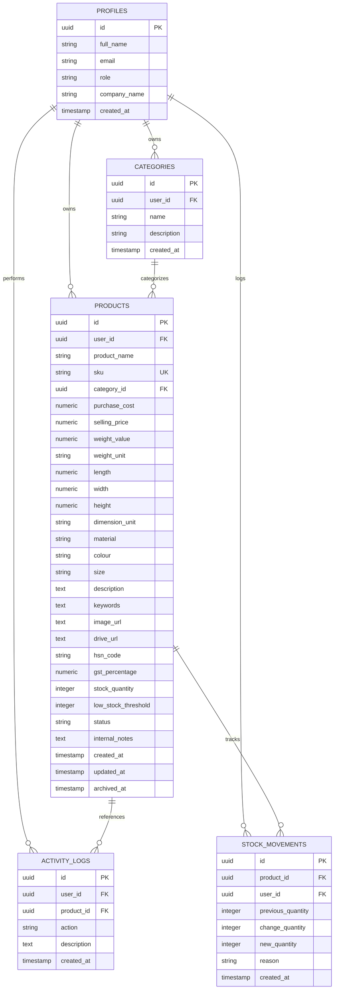

# INNOVEXA – Product Inventory & Listing Manager

[](https://nextjs.org/)
[](https://react.dev/)
[](https://www.typescriptlang.org/)
[](https://tailwindcss.com/)
[](https://supabase.com/)

A modern B2B SaaS web application built for **Innovexa Technologies** (Practical Technical Assessment for Full Stack Developer Intern).

This platform replaces scattered spreadsheets, shared drives, and manual notes with a unified, high-performance product inventory and marketplace listing manager.

---

## 1. Executive Summary & Architectural Decisions

### Why Next.js & Supabase PostgreSQL instead of Node/Express + MongoDB?

The assessment prompt suggested React.js, Node.js + Express, and MongoDB, while allowing equivalent modern stacks with clear architectural reasoning:

1. **Relational Data Integrity for E-Commerce & Inventory**:
   E-commerce and listing systems have strict relational dependencies (Products ↔ Categories ↔ Stock Movements ↔ Activity Logs). PostgreSQL enforces foreign key constraints, numeric precision for financial pricing (`NUMERIC(12, 2)` instead of floating-point IEEE-754 errors), non-negative check constraints (`CHECK (stock_quantity >= 0)`), and unique SKU guarantees.
2. **True Row Level Security (RLS)**:
   Supabase PostgreSQL provides database-level multi-tenancy. Every query is filtered at the database engine level via `auth.uid() = user_id`, eliminating accidental cross-tenant data leakage.
3. **Unified Full-Stack App Router Architecture**:
   Next.js 16 App Router with Server Actions eliminates boilerplate REST endpoints, delivers end-to-end type safety with TypeScript and Zod, and drastically reduces network roundtrips with instant server-side data fetching.
4. **Zero-Friction Evaluation & Cloud Scalability**:
   Seamlessly deployable to Vercel and Supabase Cloud with built-in SSR caching, optimized image delivery, and instant database migrations.

---

## 2. Core Feature Matrix

| Feature | Assessment Requirement | Implementation Details |
|---|---|---|
| **Product Catalog CRUD** | Required | Complete Create, Read, Update, Archive, and Delete with inline validations |
| **Field Specification** | Required | Name, SKU, Category, Cost/Price (INR), Dimensions (L×W×H), Weight (g/kg), Material, Colour, Size, HSN Code, GST %, Keywords, Image URL, Drive URL, Status, Notes |
| **Search & Multi-Filtering** | Required | Real-time search across product name and SKU; filter by category, status, and archived state |
| **Multi-Column Sorting** | Required | Sort by price, stock quantity, and creation date |
| **Pagination** | Required | Configurable pagination with item counters and navigation buttons |
| **Inventory Thresholds** | Required | Dedicated inventory overview with configurable low-stock thresholds and depletion alerts |
| **Stock Adjustments** | Enhancement | Stock adjustment modal with audit tracking in `stock_movements` and `activity_logs` |
| **Categories Management** | Required | Dedicated Category manager with assigned product counts and deletion safety guards |
| **CSV Bulk Import / Export** | Enhancement | RFC-4180 compliant CSV export and previewed import with validation and duplicate detection |
| **Reports & Analytics** | Required | Valuation summaries, category distribution, stock health, and status breakdowns |
| **Audit Activity Log** | Required | Real-time event logging of product creations, updates, archives, deletions, and adjustments |
| **Supabase Authentication** | Enhancement | Email/password login, registration, password reset, and protected routes with SSR session handling |
| **Design & Accessibility** | Required | Dark and light themes inspired by Stripe/Linear dashboards, smooth scrolling via Lenis, responsive on mobile/tablet/desktop |
| **Realistic Demo Data** | Required | 20 pre-seeded products across 5 categories with varying Indian prices, dimensions, and statuses |

---

## 3. Technology Stack

- **Frontend Framework**: Next.js 16 (App Router)
- **UI Library & Styling**: React 19, Tailwind CSS v4, Lucide React icons
- **Smooth Scrolling**: Lenis (`lenis`)
- **Validation**: Zod schema validation
- **Backend & Database**: Next.js Server Actions & Route Handlers, Supabase PostgreSQL with Row Level Security (RLS)
- **Authentication**: Supabase Auth (SSR Cookie Session Management)
- **Data Export**: RFC-4180 streaming CSV exporter

---

## 4. Database Schema & Architecture

The database architecture is defined in `supabase/migrations/20260101000000_create_schema.sql`:



### Row Level Security (RLS) Policies
- All tables (`profiles`, `categories`, `products`, `activity_logs`, `stock_movements`) have RLS enabled.
- Queries and mutations are restricted to `auth.uid() = user_id`, guaranteeing full workspace isolation.

---

## 5. Folder & Project Structure

```
product-inventory-manager/
├── src/
│   ├── app/
│   │   ├── (auth)/                  # Public auth routes
│   │   │   ├── login/               # User login
│   │   │   ├── signup/              # User registration
│   │   │   ├── forgot-password/     # Password reset request
│   │   │   └── reset-password/      # New password update
│   │   ├── (dashboard)/             # Protected workspace routes
│   │   │   ├── dashboard/           # Main executive overview
│   │   │   ├── products/            # Catalog listing & search table
│   │   │   │   ├── new/             # Add product form
│   │   │   │   └── [id]/            # Product details & edit
│   │   │   ├── categories/          # Category management
│   │   │   ├── inventory/           # Stock overview & quick adjuster
│   │   │   ├── reports/             # Analytics & valuation reports
│   │   │   ├── import-export/       # CSV import & export center
│   │   │   ├── activity/            # Event audit trail
│   │   │   └── settings/            # Workspace preferences & database status
│   │   ├── api/
│   │   │   ├── auth/callback/       # Supabase OAuth/email callback handler
│   │   │   └── export/              # Streaming CSV download route
│   │   ├── globals.css              # Theme tokens & styling
│   │   ├── layout.tsx               # Root layout & providers
│   │   └── page.tsx                 # Public landing page
│   ├── components/
│   │   ├── categories/              # Category management components
│   │   ├── dashboard/               # Analytics cards, charts & tables
│   │   ├── forms/                   # Product & profile forms
│   │   ├── import-export/           # CSV preview and validation UI
│   │   ├── inventory/               # Inventory health dashboard
│   │   ├── layout/                  # Sidebar, Topbar, and Mobile Navigation
│   │   ├── products/                # Product table and stock dialogs
│   │   ├── reports/                 # Department distribution reports
│   │   └── shared/                  # Lenis smooth scroll, Theme toggle
│   ├── lib/
│   │   ├── actions/                 # Server Actions (products, categories, auth, etc.)
│   │   ├── supabase/                # SSR client, server client & middleware
│   │   ├── validations/             # Zod validation schemas
│   │   └── utils.ts                 # Currency & date formatters
│   ├── types/                       # TypeScript interfaces
│   └── middleware.ts                # Route protection middleware
├── supabase/
│   ├── migrations/
│   │   └── 20260101000000_create_schema.sql  # Full PostgreSQL DDL & RLS
│   └── seed.sql                     # Realistic 20-product seed script
├── .env.example                     # Environment template
└── README.md                        # Documentation
```

---

## 6. Local Setup Instructions

### Prerequisites
- Node.js version 18.17+ or 20+ (Node v24 tested)
- npm version 9+

### 1. Clone & Install Dependencies
```bash
git clone <repository-url>
cd "product inv"
npm install
```

### 2. Configure Environment Variables
Create `.env.local` in the project root:
```bash
cp .env.example .env.local
```

Populate with your Supabase credentials:
```env
NEXT_PUBLIC_SUPABASE_URL=https://your-project.supabase.co
NEXT_PUBLIC_SUPABASE_ANON_KEY=your-supabase-anon-key
NEXT_PUBLIC_APP_URL=http://localhost:3000
```

> **Note**: If you want to evaluate immediately without creating a Supabase cloud project first, the application includes an automatic demo dataset and fallback persistence mode.

### 3. Run Supabase Database Migrations
In your Supabase project's **SQL Editor**:
1. Copy and execute `supabase/migrations/20260101000000_create_schema.sql`.
2. Copy and execute `supabase/seed.sql` to register the stored procedure `seed_demo_data_for_user(target_user_id)`.

### 4. Run Development Server
```bash
npm run dev
```
Open [http://localhost:3000](http://localhost:3000) in your browser.

### 5. Production Build Verification
To verify TypeScript types and production bundle:
```bash
npm run build
npm start
```

---

## 7. Sample Dataset & Demo Instructions

The platform comes pre-packaged with **20 realistic products** across 5 categories:
- **Electronics**: ANC Studio Headphones, GaN Fast Chargers, 4K Webcams, Keyboards.
- **Furniture**: Mesh Ergonomic Chairs, Solid Teak Desks, Dual Monitor Risers.
- **Accessories**: Full-Grain Leather Sleeves, Weatherproof Tech Pouches.
- **Home & Living**: Smart Ambient Light Bars, Ceramic Diffusers, Hand-Carved Coasters.
- **Industrial Supplies**: Digital Vernier Calipers, Heavy Duty Tape Dispensers, ESD Mats.

### Testing Features Quickly:
1. **Explore Products**: Visit `/dashboard/products` to test real-time search, category dropdowns, status filtering, and multi-column sorting.
2. **Add / Edit Product**: Create a new SKU or edit an existing one; verify image previews and validation messages.
3. **Stock Adjustment**: Click **Adjust Stock** on any item in `/dashboard/products/[id]` or `/dashboard/inventory` and observe stock movement updates.
4. **CSV Export & Import**:
   - Go to `/dashboard/import-export`.
   - Click **Download CSV Template** or **Export All Products**.
   - Drop a CSV to preview the rows, view duplicate detection, and execute batch imports.
5. **Theme Switching**: Click the Sun/Moon toggle in the top-right header to switch seamlessly between dark and light modes.
6. **Reload Sample Data**: Click **Seed Demo Data** in the top navigation bar at any time to refresh the 20 sample items.

---

## 8. Deployment to Vercel

1. Push your repository to GitHub.
2. Import the repository in [Vercel](https://vercel.com).
3. In Project Settings → Environment Variables, add:
   - `NEXT_PUBLIC_SUPABASE_URL`
   - `NEXT_PUBLIC_SUPABASE_ANON_KEY`
   - `NEXT_PUBLIC_APP_URL` (set to your Vercel deployment URL)
4. In Supabase Dashboard → Authentication → URL Configuration:
   - Add your Vercel URL to **Site URL** and **Redirect URLs** (`https://your-domain.vercel.app/api/auth/callback`).
5. Deploy.

---

## 9. Assumptions & Trade-Offs

- **Currency**: Primary business operations and listings are pegged to INR (₹) with HSN codes and GST percentages aligned with Indian e-commerce seller compliance.
- **Image Hosting**: URLs (such as CDN or cloud storage links) are stored and rendered with fallback error handlers and preview cards.
- **Skills Note**: As requested in the instructions, the Antigravity skills were audited prior to development: the `ponytail` minimal-engineering skill was utilized to keep abstractions pragmatic and zero-bloat; `stageshow` and `dashboard ui` were not installed in the execution environment, so high-performance React/Tailwind/Lucide/CSS transitions and Radix-style dashboard standards were implemented as the closest production-ready alternative.

---

## 10. Contact & Ownership

- **Author**: Candidate for Full Stack Developer Intern
- **Organization**: Innovexa Technologies Technical Practical Assessment
# inventory-

